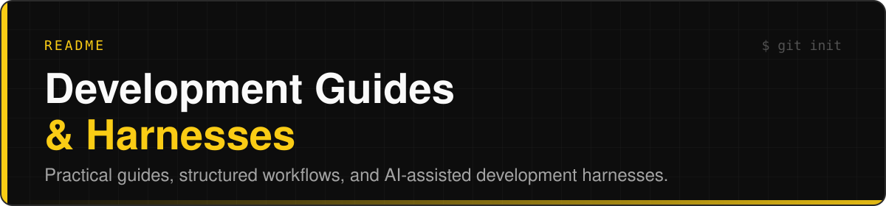

# 

<p align="center">
  
</p>

<p align="center">
  
  
  
</p>

<p align="center">
  
</p>

## Overview

A collection of interactive resources covering software project preparation, version control, and AI-assisted development. These guides are designed to provide structured starting points, encourage sound engineering practices, and support the development of maintainable software projects.

<p align="center">
  
</p>

## Table of Contents

* [Overview](#overview)
* [Available Guides](#available-guides)
  * [Project Foundations](#project-foundations)
  * [Git and GitHub](#git-and-github)
  * [AI Development Harness](#ai-development-harness)
* [Adaptation and Configuration](#adaptation-and-configuration)
* [How to Use](#how-to-use)
* [Repository Structure](#repository-structure)
* [Disclaimer](#disclaimer)

<p align="center">
  
</p>

## Available Guides

### Project Foundations

**STEP 00** · Project Planning & Architecture

**File:** [`Step0-Bones.html`](Step0-Bones.html)[cite: 4]

An interactive guide covering the preparation of a software project, from the initial idea to Git initialization.

**Topics covered:**

* Brainstorming, requirements, and MVP definition[cite: 1].
* Domain modeling and software architecture[cite: 1].
* UML diagrams and database design[cite: 1].
* REST API contracts and OpenAPI[cite: 1].
* Project documentation and technical decisions[cite: 1].
* Initial environment and project setup[cite: 1].

**Scope:** From concept to `git init`[cite: 1].

---

### Git and GitHub

**STEP 01** · Version Control & Collaboration[cite: 1]

**File:** [`Step1-Git.html`](Step1-Git.html)[cite: 4]

A practical guide to Git and GitHub, covering repository initialization, development workflows, common operations, and troubleshooting[cite: 1].

**Topics covered:**

* Repository initialization and configuration[cite: 1].
* Branching strategies and commit management[cite: 1].
* Pull requests, code reviews, and merges[cite: 1].
* Everyday Git commands and operations[cite: 1].
* Conflict resolution and error recovery[cite: 1].
* Repository maintenance[cite: 1].

**Scope:** From the first commit to established Git workflows[cite: 1].

---

### AI Development Harness

**STEP 02** · AI Agents & Development Automation[cite: 1]

**File:** [`Step2-Opencode.html`](Step2-Opencode.html)[cite: 4]

An interactive implementation guide for configuring a specific multi-agent software development environment using OpenCode, Codex, Claude, and Gemini[cite: 1].

**Topics covered:**

* Agent architecture, roles, and responsibilities[cite: 1].
* Subagents and orchestration[cite: 1].
* Configuration files and permissions[cite: 1].
* AI-assisted implementation and code review[cite: 1].
* Automated development logs[cite: 1].
* Monitoring scripts and coordinated workflows[cite: 1].
* Validation and operational procedures[cite: 1].

**Scope:** A project-specific AI development harness, intended for adaptation rather than direct replication[cite: 1].

<p align="center">
  
</p>

## Adaptation and Configuration

**These guides are starting points, not universal procedures or rigid development standards[cite: 1].**

Every software project has its own architecture, technologies, constraints, and requirements[cite: 1]. When applying these guides:

* Some steps may be unnecessary[cite: 1].
* Additional steps may be required[cite: 1].
* Procedures may need to be modified or reordered[cite: 1].
* Configuration files and scripts must be adapted to the target environment[cite: 1].
* Agent roles, permissions, and automation mechanisms must be reviewed individually[cite: 1].
* Technical decisions must be validated against project-specific requirements[cite: 1].

**Understand the process. Evaluate its relevance. Adapt the implementation[cite: 1].**

> [!TIP]
> The goal is to encourage informed engineering decisions, not mechanical execution of predefined instructions[cite: 1].

<p align="center">
  
</p>

## How to Use

The guides are distributed as interactive HTML documents[cite: 1].

1. Select a guide from the Available Guides section[cite: 1].
2. Download or view the corresponding HTML file[cite: 1].
3. Open it in a modern web browser[cite: 1].
4. Follow the instructions and use the interactive checklists[cite: 1].
5. Adapt the procedures, examples, and configurations to your project[cite: 1].

The guides follow a suggested sequence but can also be consulted independently[cite: 1].

<p align="center">
  
</p>

## Repository Structure

```text
Development-Guides-Harnesses/
├── assets/
│   ├── banner.svg
│   └── divider.svg
├── scripts/
│   └── make_banner.py
├── Step0-Bones.html
├── Step1-Git.html
├── Step2-Opencode.html
├── .gitattributes
├── .gitignore
└── README.md
